# EnerLens Card

Eine Energiefluss-Karte für Home Assistant. Das bekannte Kreuz aus PV, Netz,
Haus und Batterie — dazu eine Aufschlüsselung, woraus der Hauswert eigentlich
besteht.

**Dokumentation und Live-Demo: <https://wawersich.github.io/enerlens-card/de/index.html>**

*[English version of this page](README.md)*

<picture>
  <source media="(prefers-color-scheme: dark)" srcset="docs/images/card-de-dark.svg">
  
</picture>

## Was sie anders macht

- **Verbraucher als Aufschlüsselung:** Liste und Ring zeigen, woraus der
  Hauswert besteht; der Rest fasst zusammen, was nicht einzeln gemessen wird.
- **Mittelwerte:** 2 und 15 Minuten, frei einstellbar, beruhigen das Bild,
  ohne die Zahlen zu verfälschen.
- **Energie statt Leistung:** Heute, 24 h, Woche, 7 Tage, Monat, 30 Tage —
  aus der Statistik der Leistungssensoren, ohne Energie-Sensoren.
- **E-Auto an der Wallbox:** Ein Ring um das Symbol zeigt den Ladestand.
- **Zusatzwerte an den Knoten:** Tagesertrag, Autarkie, Restenergie und alles
  andere, was eine Entität hergibt.
- **Netzausfall:** rote Leiste und durchgestrichener Netz-Knoten statt „0 W“.
- **Alles im Editor:** fast jede Einstellung ist ein Klick, die Karte live
  daneben — auch die Farben.

Ausprobieren lässt sich das alles auf der
[Homepage](https://wawersich.github.io/enerlens-card/de/index.html): Die
Karten dort sind keine Bilder, sondern die echte Karte mit ausgedachten Werten.

## Installation

### HACS

1. HACS → ⋮ → *Benutzerdefinierte Repositories* → `https://github.com/wawersich/enerlens-card`
   hinzufügen, Typ *Dashboard*
2. Nach *EnerLens* suchen, installieren, Browser neu laden
3. HACS trägt die Ressource `/hacsfiles/enerlens-card/enerlens-card.js` selbst
   ein; erscheint die Karte nicht, unter *Einstellungen → Dashboards →
   Ressourcen* nachsehen

### Von Hand

1. `enerlens-card.js` aus dem letzten Release herunterladen
2. Nach `config/www/` kopieren
3. Unter *Einstellungen → Dashboards → Ressourcen* eintragen:
   `/local/enerlens-card.js` als *JavaScript-Modul*

## Erste Schritte

Im Dashboard *Karte hinzufügen* → *EnerLens*. Der Editor führt durch alles
Weitere; YAML braucht es nicht. Wer es trotzdem vorzieht:

```yaml
type: custom:enerlens-card
entities:
  solar: sensor.pv_leistung
  grid: sensor.netz_leistung
  house: sensor.hausverbrauch
```

## Dokumentation

Die vollständige Anleitung — Einrichtung, alle Funktionen und alle Optionen —
steht auf der [Homepage](https://wawersich.github.io/enerlens-card/de/index.html).

## Lizenz

MIT
