# EnerLens Card

An energy flow card for Home Assistant. The familiar cross of PV, grid, house
and battery — plus a breakdown of what the house figure is actually made of.

**Documentation and live demo: <https://wawersich.github.io/enerlens-card/en/index.html>**

*[Deutsche Fassung dieser Seite](README.de.md)*

<picture>
  <source media="(prefers-color-scheme: dark)" srcset="docs/images/card-en-dark.svg">
  
</picture>

## What it does differently

- **Consumers as a breakdown:** list and ring show what makes up the house
  value; the remainder holds everything not measured individually.
- **Moving averages:** 2 and 15 minutes, configurable, calm the picture
  without falsifying the numbers.
- **Energy instead of power:** today, 24 h, week, 7 days, month, 30 days —
  from the statistics of the power sensors, no energy sensors needed.
- **EV at the wallbox:** a ring around the icon shows the state of charge.
- **Extra values at the nodes:** today's yield, self-sufficiency, energy left
  in the battery and anything else an entity provides.
- **Grid outage:** a red banner and a crossed-out grid node instead of "0 W".
- **All in the editor:** almost every setting is a click, with the card live
  beside it — colours included.

You can try all of this on the
[website](https://wawersich.github.io/enerlens-card/en/index.html): the cards
there are not pictures but the real card with invented values.

## Installation

### HACS

1. HACS → ⋮ → *Custom repositories* → add `https://github.com/wawersich/enerlens-card`,
   type *Dashboard*
2. Search for *EnerLens*, install, reload the browser
3. HACS registers the resource `/hacsfiles/enerlens-card/enerlens-card.js` for
   you; if the card does not appear, check *Settings → Dashboards → Resources*

### Manually

1. Download `enerlens-card.js` from the latest release
2. Copy it to `config/www/`
3. Add it under *Settings → Dashboards → Resources* as
   `/local/enerlens-card.js`, type *JavaScript module*

## Getting started

In the dashboard, *Add card* → *EnerLens*. The editor takes it from there; no
YAML needed. If you prefer it anyway:

```yaml
type: custom:enerlens-card
entities:
  solar: sensor.pv_power
  grid: sensor.grid_power
  house: sensor.house_power
```

## Documentation

The full guide — setup, every feature and every option — is on the
[website](https://wawersich.github.io/enerlens-card/en/index.html).

## Licence

MIT
